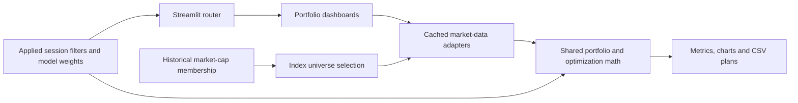

# Portfolio Pulse: product and codebase review

## Objective

Portfolio Pulse helps a self-directed investor answer three questions: **How did my allocation perform? What risks did I take? What would a better-constrained allocation look like?** Its broader research dashboards add asset-class context and thematic accumulation signals. It is a research and simulation application, with no brokerage account connection, portfolio ledger, authentication, order execution, or persistent user database.

The product's strongest existing component is Smart Money Radar: small thematic baskets, price/volume accumulation signals, cross-sectional scoring, lifecycle stages, historical stage comparisons, and SEC filing confirmation. Its pure math and parser modules already have substantial tests. The largest opportunity was to bring the core portfolio workflow to the same standard of testability and clarity.

## Structure and responsibilities

| Area | Responsibility |
| --- | --- |
| `streamlit_app.py`, `1_💼_Portfolio_Pulse.py` | Equivalent entrypoints calling one router. |
| `common/navigation.py` | Registry of 11 dashboards in six asset classes; renders Equities — Linear first and expanded by default, with Portfolio Pulse as the landing page. Single-page categories remain direct parent links. Renders shared portfolio filters before dispatch. |
| `common/sidebar.py` | Validated, explicitly applied ticker/date/benchmark/risk-free settings; session persistence; cache refresh. |
| `common/data.py` | Cached Yahoo price and OHLCV adapters, conservative DuckDB fallback, snapshot benchmark and CSV reference access. |
| `common/portfolio.py` | UI-independent weights, price alignment, wealth, performance/risk metrics, attribution, and dollar rebalance math. |
| `common/optimization.py` | Long-only constrained optimization, fresh-solver fallback, comparable allocation estimates, and frontier points. |
| `common/portfolio_ui.py` | Consistent data-state handling, headline metrics, growth charts, and methodology explanations. |
| `common/presentation.py`, `assets/workspace.css` | Shared workspace branding, page headers, context chips, chart template, and responsive visual styling. |
| `common/indices.py` | Parameterized historical membership queries, archive boundaries, and composition changes. |
| `common/smart_money.py`, `common/themes.py` | Thematic universe, accumulation signals, relative strength, scoring and lifecycle classification. |
| `common/sec_edgar.py` | SEC fair-access requests, Form 4/13F parsing, issuer matching and position changes. |
| `common/options.py` | Option-chain normalization, Black–Scholes Greeks, and Max Pain. |
| `views/` | Streamlit page composition and interaction, with portfolio calculations delegated to shared modules. |
| `tests/`, `.github/workflows/ci.yml` | Pure-math, provider-adapter, parser, routing and Streamlit interaction regression tests; compilation and deployment dependency checks. |

## Findings and implemented improvements

| Finding | Resulting behavior |
| --- | --- |
| Random defaults and page-owned filter widgets made analyses difficult to reproduce or carry between dashboards. | Deterministic five-stock starter model; filters live in the entrypoint, with applied settings kept separately from widget state. Custom weights carry across portfolio pages. |
| The overview buried decisions below raw tables and automatic optimization. | Return/risk KPIs lead; overview, asset performance, diversification, and exports are tabbed. Optimization lives on its dedicated page. |
| Company market capitalization was presented as the investor's current allocation; median-based targets could fail to sum to 100%. | Explicit editable model weights, a 100% validation rule, concentration metrics, and a dollar trade plan against a fully invested constrained target. No brokerage positions are invented. |
| Portfolio pages used different return paths, date types and benchmark windows. | One fixed-weight model and a normalized common calendar. Benchmark prices align before returns are calculated, so both series have the same baseline and observations. |
| Portfolio correlations were based on price levels. | Portfolio correlation charts use asset returns. |
| Drawdowns could miss the first observed loss; EWMA VaR mixed daily and annual horizons; Sortino used only the standard deviation of negative days. | Initial wealth is included in peak calculations; all VaR tiles share the daily horizon; downside deviation uses RMS negative excess returns over all observations. Undefined ratios display an em dash. |
| The synthetic equal-weight benchmark averaged dollar share prices. | It compounds equal-weight constituent returns, independent of share-price scale, and identifies its universe as a historical CSV snapshot. |
| Index Insights treated average market cap as investable index performance and filtered index membership to the user's holdings. | Index performance comes from adjusted prices with equal weights. Archived membership is independently selectable and explicitly dated; future-selected membership is flagged. Missing constituents prevent an incomplete index from being presented as the full universe. |
| Raw local prices could be mixed with adjusted live observations; a partial local result could silently satisfy a larger request. | Portfolio analytics explicitly request adjusted prices and bypass the raw store. Other callers use local data only when all symbols and the requested bounds are covered. Yahoo end dates now match the inclusive database convention. |
| The optimizer reused an instance after a failed maximum-Sharpe solve and compared inconsistent Sharpe estimates. | A fallback creates a fresh solver; current and target estimates use identical means, covariance, risk-free rate and constraints. The frontier uses actual risk/return pairs. |
| The options payout directions were reversed, and the fallback chain was expected to expose expiry metadata it does not contain. | Call payout is `max(settlement - strike, 0)`, put payout is `max(strike - settlement, 0)`; Yahoo expiry metadata is preserved separately. Asymmetric payoff and fallback-render tests cover these regressions. |
| Market-cap reference amounts came from an INR-labelled snapshot while the UI displayed dollars. | Holdings uses that file only for company names and domicile. It no longer labels the reference amounts as the user's dollar holdings. |

## Model and data contract

- Portfolio allocations are long-only, fully invested, and rebalanced to fixed weights at every observed common close. Changes to weights apply to the entire historical simulation; they do not create dated transactions.
- Prices are split/dividend adjusted. Index-symbol benchmarks such as `^GSPC` are price indices, so their dividend treatment differs. Adjusted SPY and QQQ benchmark choices are available.
- Common complete price dates are selected without forward-filling. The effective date window and excluded-row count are shown. A gap means consecutive observations may span multiple trading days; the 252-observation risk annualization remains an approximation.
- Total return compounds the actual window. CAGR uses elapsed calendar time. Sharpe and Sortino use a user-selected annual effective risk-free rate converted to a daily rate. VaR/CVaR are historical one-observation loss estimates; EWMA uses a normal approximation with decay 0.94.
- Linked contribution accounting sums to the daily-rebalanced model's total return. Dollar rebalance plans sum to zero before costs; their baseline is the fixed model allocation, not a brokerage account or a drifted buy-and-hold portfolio.
- Market data caches expire after one hour and can be cleared with **Refresh market data**. User settings and custom weights last only for the current Streamlit session.
- `data/market_data.db` has no tables in the supplied checkout. `data/market_cap_data.db` contains 427,260 rows for 250 symbols, covering 6 January 2020 through 19 March 2025. The CSV company references are historical, not live company fundamentals.
- The radar's price/volume signals are accumulation proxies. Form 4 buys and lagged 13F holdings are filing evidence, not a real-time institutional order feed.

## Validation

Regression coverage exercises weighted wealth and attribution, initial-loss drawdowns, loss horizons, benchmark baselines, invalid allocations, optimizer caps and fallback isolation, date-inclusive Yahoo adapters, partial local coverage, archived membership, and asymmetric options payouts. Streamlit AppTest runs the six equity routes, filter navigation, allocation apply/reset, missing providers, short histories, custom-weight consistency and the Yahoo option fallback without remote requests.

Live Yahoo adjusted prices were separately fetched for AAPL and MSFT through the requested end date. Chromium also loaded the default five-asset overview with real market data, applied a three-ticker selection, navigated to Risk Wall, Rebalancing and Holdings, and confirmed the selection persisted with no browser exceptions. Desktop (1440 px) and mobile (390 px) screenshots were visually reviewed. The running service's health and favicon endpoints returned HTTP success. No live SEC or NSE service guarantee is implied by their deterministic parser and fallback tests.

## Next product increments

1. **Real holdings and a transaction ledger.** Add validated brokerage CSV import, quantities, cost basis, cash, dated trades and corporate actions before calling the model an account tracker. This enables money-weighted and time-weighted account returns and drift-based rebalancing.
2. **Saved workspaces.** Add deliberate persistence and restore/export for portfolio definitions, benchmark choices and research watchlists; define identity and storage ownership before introducing multi-user accounts.
3. **Provider observability.** Preserve per-symbol retrieval status, adjustment metadata, timestamps and short-lived failure caching. Offer source-specific retry controls and separate outage diagnostics from “no history.”
4. **More defensible allocation estimates.** Add shrinkage covariance, return-estimation choices, turnover/cost penalties and walk-forward validation. Current frontier and optimized weights remain in-sample estimates.
5. **Point-in-time research data.** Refresh and version membership/reference snapshots, include delisted securities and cash treatment, and distinguish survivorship bias from a genuine historical index backtest.
6. **Cross-asset methodology pass.** Crypto still has its own 365-day risk implementation; mixed-calendar correlations and futures contract rolls need explicit conventions before their metrics can share the equity engine. Rates are quoted yield indices rather than bond total returns.
7. **Options market conventions.** Parameterize the hardcoded risk-free rate, expiry time zone and contract settlement time; validate selected-index option availability and explain the limits of Black–Scholes Greeks for each source.
